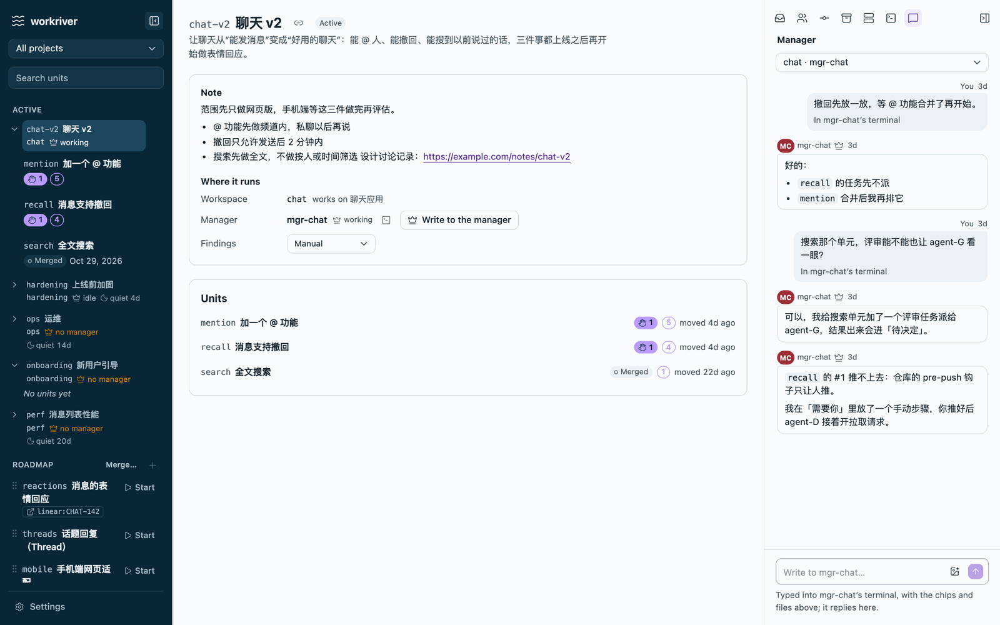
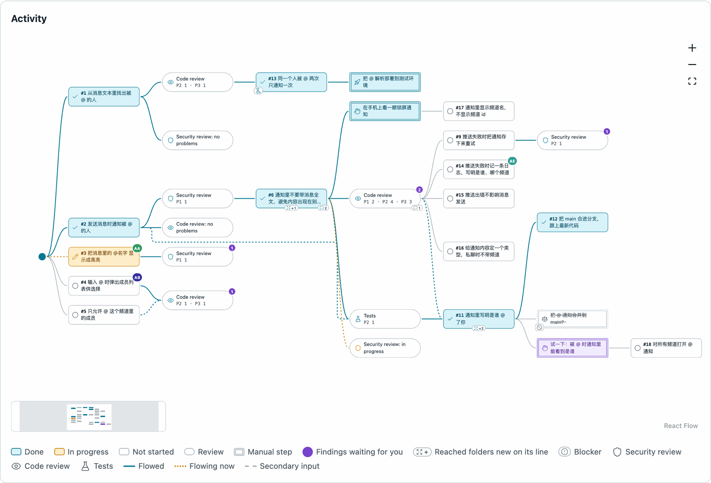
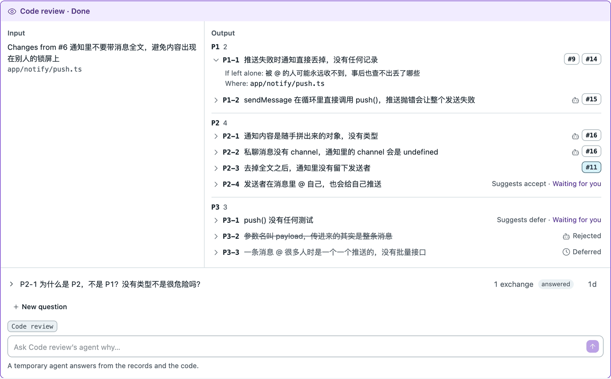
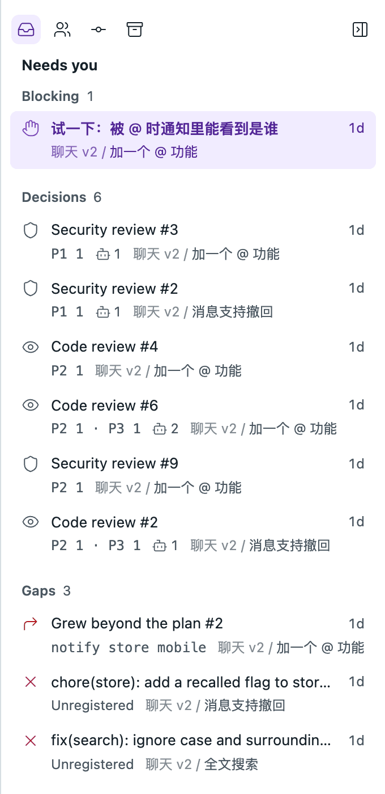
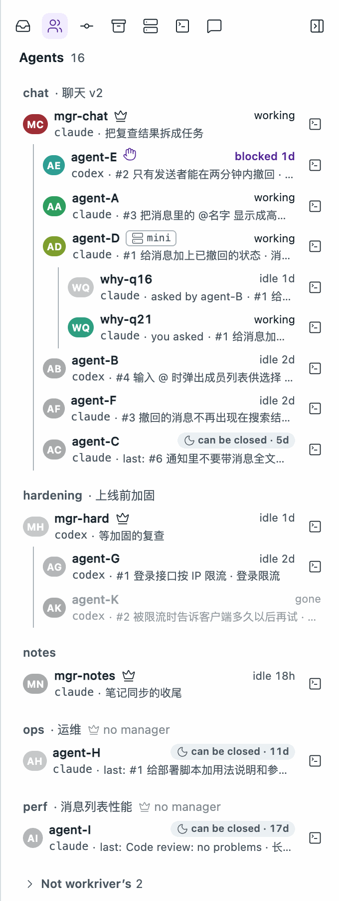
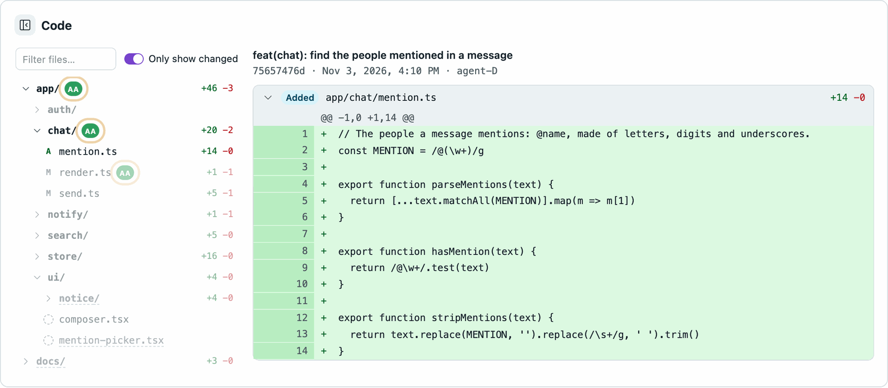

# workriver

[中文](docs/README.zh-CN.md)

Keep track of many coding agents working in parallel.


## Twenty agents, one person

You split a goal into pieces and start an agent on each. One writes the parser, one wires
up notifications, two review what the others wrote, another adds tests. By the afternoon
twenty sessions are running across your Herdr workspaces, and the questions that matter
have no easy answer:

- **What is each agent doing right now?** The answer is spread over twenty terminals. You
  tab through panes and read the last screen of each.
- **How did this piece of work come to be the way it is?** A review asked for a change,
  you agreed in one terminal, an agent fixed it in another. A week later the code is all
  that is left; the reasons scrolled away.
- **Which parts of the code did it reach?** Branches and commits say what changed, not
  which task asked for it or which review it answered.
- **What is waiting on you?** An agent sits on an approval in a pane you are not looking
  at, a manual try-out nobody did holds up a whole branch, and findings pile up with no one
  deciding them.

workriver is where those answers live. It runs on your machine as one service, records the
work as it happens and shows it in a browser. It records and shows; it does not start or
schedule agents.

## How it works

Three things feed it:

- **Agents say what they do** by running the `workriver` CLI from their shell, which every
  harness can do: `workriver task start u1#3` when they begin, a `Task: u1#3` line in each
  commit message, and `workriver task deliver u1#3 --evidence 'cargo test => passed: 12 passed'`
  when they hand the work in. The service tells who is calling from where the command
  runs, so no harness is configured and nobody is anyone by saying so.
- **[Herdr](https://herdr.dev) says who is running**, where, and in what state, and carries
  messages to agents.
- **One manager agent per Herdr workspace plans.** It splits an intent into units and
  tasks and hands the tasks to worker agents it starts by name. When it needs you (before a
  merge, a deploy, anything destructive) it asks through Needs you, not in its terminal,
  and what it has to tell you arrives there too. A worker stuck on what only you can do
  (a refused push, a missing login) puts a blocker before its own task, and goes on once
  you have done it. workriver records and delivers; the manager schedules.

What they report becomes one picture, in a few terms. A **project** is a folder of
repositories. An **intent** is a goal in it. A **unit** is a piece of an intent built on
its own branch, in a worktree of its own; research and design for the whole intent go in a
research unit, which has no branch and is never merged, and an experiment goes in a spike,
whose code is kept on its branch to show how and never merged. A **task** is one piece of
work handed to one agent (implement, review, tests, design, research) or to you: a **gate**
("Manual step" in the UI), a step only you can do, such as a manual deploy, a try-out or a
decision, that an agent waits on; one an agent puts before its own task when it is stuck
is a blocker. A **finding** is a problem a review, tests or a gate found. **Evidence** is
a check run on a task's work, the command and its result.

## One intent, from goal to merge

The pictures come from the sample data built into the UI: a chat app, its content written
in Chinese.

**The goal.** The chat app needs @-mentions, message recall and search. The intent "聊天 v2"
waits in the project's roadmap with a one-sentence goal. You press "Start" next to it and
pick the Herdr workspace "chat"; its manager, mgr-chat, is told and splits the intent into
units, one of them "加一个 @ 功能" (add @-mentions) on the branch `feat/mention`. The intent
has a page of its own: the goal, a note that grows as decisions are made, where it runs,
who decides its findings, and its units with where each stands. "Write to the manager"
opens a conversation beside it: what you write is typed into mgr-chat's terminal, and its
replies come back to the page. The manager can start a message too; here it tells you that
a push in another unit is waiting for you.



**The work as a graph.** Inside the unit, every task is a node in the activity graph, with
an input and an output. #1 finds the people a message mentions, #2 notifies them, and a
review follows each. When a review raises findings the flow branches: each accepted
finding leads to new tasks, and the lines join again where the work does. An amber dotted
line is work flowing now, dashed lines are secondary inputs, and a violet count marks
findings waiting for you. A blocker carries a "!" mark, and the task it holds up a violet
hand; this unit has none (the unit "消息支持撤回" does), and the hand on the try-out gate
near the end is that gate's own sign. A small "+N" under a node says its commits reached N
folders that nothing before it on its line had touched: there the work grew in scope. A
long graph opens on its latest work, with a minimap of the whole; zoomed out, as here, all
of it shows.



**Why a node is the way it is.** Pick a node and its detail says what went in and what came
out. Task #1 was asked to find the people mentioned in a message; it delivered the commit
"feat(chat): find the people mentioned in a message", its reports and screenshots, and a
check, `npm test app/chat/mention.test.ts`, 6 passed. Evidence is recorded the same way
whoever ran it. "Ask why" opens a question in the side panel: a temporary agent answers
from the records and the code, and asks the agent that did the work only while that agent
is idle. With no node picked, the question is about the whole unit.


**Findings, decided once.** The code review of #6 found nine problems, rated P1 to P3. Each
is accepted, revised (accepted, but fixed your way), rejected or deferred. By default the
intent's manager decides them: a decision it made carries a small robot, like P1-2 and the
rejected P3-2, and you can always decide differently. P1-1 was accepted and led to tasks #9
and #14; P3-3 was deferred to the project's backlog, where deferred findings wait to be
done together in one batch or dropped. On its page 聊天 v2 is set to "Findings: Manual", so
what is still open waits for you: P2-4 and P3-1, each with the reviewer's suggestion. Every
decision goes to the manager, and an accepted finding stays visible on the tasks it caused,
since that work must meet it.



**What is waiting on you.** Needs you is one queue across every workspace. First what
blocks someone: agents waiting for a person in their terminal, workers that stopped
without delivering, and gates, among them the questions a manager asks you (merge now?
which design?) and the blockers workers put. Here agent-E asks whether it may run
`npm test`, a gate waits for you to try whether an @ notification says who mentioned you,
and a blocker from the unit "消息支持撤回" (message recall) asks you to push its branch:
the repository's hook lets only people push. A gate's steps say what to do, and a step
with a command has "Run", which runs it in a shell of your own once you confirm it. While
you look at the confirm dialog, a temporary agent reads the command and the scripts it
calls and says what it will change, with a verdict: ok, caution or danger. It only warns;
you decide. The last runs stay listed under "Run a command" in the side panel. Then come
machines past an alert threshold, decisions on findings, the messages managers wrote that
you have not read, gaps such as a commit that names no task, and last the chores that
block nobody. Each group folds by its heading; here Machines and Decisions are folded.



**Who is doing what.** Agents are a tree by Herdr workspace: the manager, the workers under
it with the task each is on, and the temporary agents answering questions under the worker
they ask about. A blocked agent comes first with a violet hand, a gone one is greyed, and a
worker idle with nothing to do says it can be closed. Machines shows CPU, memory, pressure,
swap and disk of this machine and of the others followed over ssh, so heavy work does not
go to one that is already struggling.



**Which code it reached.** Under the graph, the unit's changes as a file tree beside the
diff, commit by commit. Files a task plans to change but has not touched yet show as
dashed circles, and an agent writing in a file right now carries its mark there. Commits,
in the side panel, draws every unit's commits as a git graph, one lane per branch, with
what agents are writing right now on top.



**Merge.** The try-out passes, you mark the gate done, and the last tasks deliver. The
manager asks in Needs you whether to merge; after your yes, push, pull request and merge
are each a task of their own. workriver sees the merge in git and the unit reads "Merged"
with its date; a squash merge, which git cannot show, is pointed out for the manager to
record. The manager then removes the unit's worktree. A research unit or a spike is never
merged: once its work is decided it reads "Ready to close". When every unit of the intent
is merged or done, its header says "Finished", for its manager to close it, along with the
workers it no longer needs.

## Status

First version, usable. The service records intents, units, tasks, findings and chores,
reads the units' commits from git, follows the agents running in Herdr, keeps each
project's roadmap and backlog, delivers your decisions, gate results and messages to the
right agent, runs the commands you confirm in your own shell after an agent has read what
they do, watches the machines' load, and serves the web UI on real data in English and
Chinese. Agents on other machines (each with its own Herdr) can be followed over ssh; that
part is new and has only been tested against stand-ins.

## Build and run

Step by step, from a fresh Mac to a manager agent in each Herdr workspace:
[Getting started](docs/getting-started.md).

Runtimes come from [mise](https://mise.jdx.dev) (`mise.toml`: Rust and Node). The web UI is
built into the binary, so build it first:

```
cd frontend/web && npm install && npm run build && cd ../..
cargo build --release
./target/release/workriver serve          # http://127.0.0.1:47820
./target/release/workriver open           # the page, signed in as you (a one-time link)
```

The page and the CLI act as you only with the user token on your machine; agents and
other machines cannot. What that does and does not protect: [Security model](docs/security.md).

Data lives in `~/workriver-data/workriver.db` (set `WORKRIVER_HOME` to move it).
`workriver --help` explains the commands. The manager of a workspace registers with
`workriver manager here` from its own pane, one per workspace, and `workriver guide
manager` / `workriver guide worker` print the instructions for agents. Herdr's socket is
`~/.config/herdr/herdr.sock` (or `HERDR_SOCKET_PATH`); without Herdr the service still
records and shows, it just sees no agents.

Working on the UI: `npm run dev` in `frontend/web` uses a running `workriver serve`;
`npm run dev:mock` uses the sample data instead.

## License

[MIT](LICENSE)
