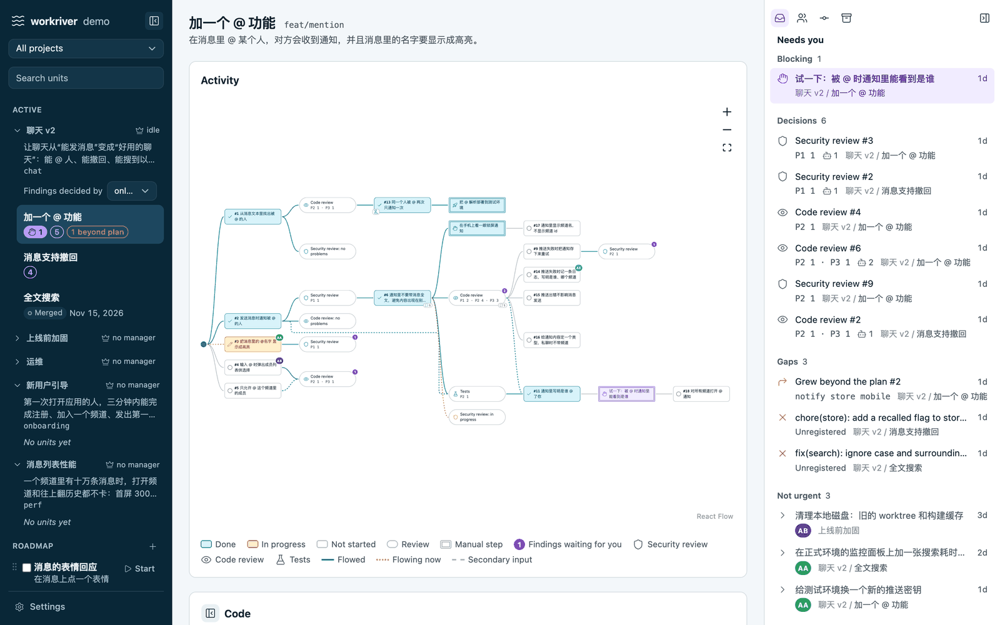
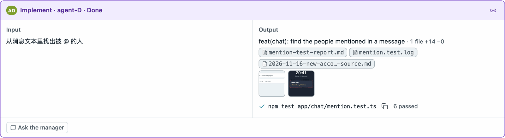

# workriver

[中文](docs/README.zh-CN.md)

Keep track of many coding agents working in parallel.



## Twenty agents, one person

You split a goal into pieces and start an agent on each. One writes the parser, one wires
up notifications, two review what the others wrote, another adds tests. By the afternoon
twenty sessions are running across your Herdr workspaces, and the questions that matter
have no easy answer:

- **What is each agent doing right now?** The answer is spread over twenty terminals. You
  tab through panes and read the last screen of each.
- **How did this piece of work come to be the way it is?** A review asked for a change,
  you agreed in one terminal, an agent fixed it in another. A week later the code is all
  that is left; the reasons scrolled away.
- **Which parts of the code did it reach?** Branches and commits say what changed, not
  which task asked for it or which review it answered.
- **What is waiting on you?** An agent sits on an approval in a pane you are not looking
  at, a manual try-out nobody did holds up a whole branch, and findings pile up with no one
  deciding them.

workriver is where those answers live. It runs on your machine as one service, records the
work as it happens and shows it in a browser. It records and shows; it does not start or
schedule agents.

## How it works

Three things feed it:

- **Agents say what they do** by running the `workriver` CLI from their shell, which every
  harness can do: `workriver task start u1#3` when they begin, a `Task: u1#3` line in each
  commit message, and `workriver task deliver u1#3 --evidence 'cargo test => passed: 12 passed'`
  when they hand the work in. The service tells who is calling from where the command
  runs, so no harness is configured and nobody is anyone by saying so.
- **[Herdr](https://herdr.dev) says who is running**, where, and in what state, and carries
  messages to agents.
- **One manager agent per Herdr workspace plans.** It starts an intent from the project's
  roadmap, splits it into units and tasks, and hands the tasks to worker agents.
  workriver records and delivers; the manager schedules.

What they report becomes one picture, in a few terms. A **project** is a folder of
repositories. An **intent** is a goal in it. A **unit** is a piece of an intent built on
its own branch. A **task** is one piece of work handed to one agent (implement, review,
tests) or to you: a **gate**, a step only you can do, such as a manual deploy or try-out,
that an agent waits on. A **finding** is a problem a review found. **Evidence** is a check
run on a task's work, the command and its result.

## One intent, from goal to merge

The pictures come from the sample data built into the UI: a chat app, its content written
in Chinese.

**The goal.** The chat app needs @-mentions, message recall and search. The intent
"聊天 v2" waits in the project's roadmap with a one-sentence goal. You start it in a Herdr
workspace; its manager splits it into units, one of them "加一个 @ 功能" (add @-mentions) on
the branch `feat/mention`, and hands out the first tasks.

**The work as a graph.** Inside the unit, every task is a node in the activity graph, with
an input and an output. #1 finds the people a message mentions, #2 notifies them, and a
review follows each. When a review raises findings the flow branches: each accepted finding
leads to new tasks, and the lines join again where the work does. An amber dotted line is
work flowing now, dashed lines are secondary inputs, and a violet count marks findings
waiting for you.


**Why a node is the way it is.** Pick a node and its detail says what went in and what came
out. Task #1 was asked to find the people mentioned in a message; it delivered the commit
"feat(chat): find the people mentioned in a message" and a check,
`npm test app/chat/mention.test.ts`, 6 passed. Evidence is recorded the same way whoever ran
it. Below it you can ask why: a temporary agent answers from the records and the code, and
asks the agent that did the work only when that agent is idle.



**Findings, decided once.** The code review of #6 found nine problems, rated P1 to P3. Each
is accepted, revised (accepted, but fixed your way), rejected or deferred. P1-1 was
accepted and led to tasks #9 and #14; P3-2 was rejected; P3-3 was deferred to the project's
backlog, where deferred findings wait to be done together in one batch or dropped; P2-4
waits for you, with the reviewer's suggestion next to it. By default the intent's manager
decides findings and you can always decide differently; for 聊天 v2 you set "Findings
decided by: only me" in the rail, so its findings wait for you. Every decision goes to
the manager, and an accepted finding stays visible on the tasks it caused, since
that work must meet it.


**What is waiting on you.** Needs you is one queue across every workspace. First what
blocks someone: agents waiting for a person in their terminal, and gates. Here an agent
waits for you to try whether an @ notification says who mentioned you. Then decisions on
findings, then
gaps such as a commit that names no task or a branch that grew beyond the plan, and last
the chores that block nobody.


**Which code it reached.** Under the graph, the unit's changes as a file tree beside the
diff, commit by commit. Files a task plans to change but has not touched yet show as
dashed circles, and an agent writing in a file right now carries its mark there.


**Merge.** The try-out passes, you mark the gate done, the last tasks deliver, and the
branch is merged. workriver sees the merge in git and the unit reads "Merged" with its
date. Once every unit of the intent is merged or done, its header says "Finished", for its
manager to close it.

## Status

First version, usable. The service records intents, units, tasks, findings and chores,
reads the units' commits from git, follows the agents running in Herdr, keeps each
project's roadmap and backlog, delivers your decisions and gate results to the right
agent, and serves the web UI on real data. Agents on other machines (each with its own
Herdr) can be followed over ssh; that part is new and has only been tested against
stand-ins.

## Build and run

Step by step, from a fresh Mac to a manager agent in each Herdr workspace:
[Getting started](docs/getting-started.md).

Runtimes come from [mise](https://mise.jdx.dev) (`mise.toml`: Rust and Node). The web UI is
built into the binary, so build it first:

```
cd frontend/web && npm install && npm run build && cd ../..
cargo build --release
./target/release/workriver serve          # http://127.0.0.1:47820
./target/release/workriver open           # the page, signed in as you (a one-time link)
```

The page and the CLI act as you only with the user token on your machine; agents and
other machines cannot. What that does and does not protect: [Security model](docs/security.md).

Data lives in `~/workriver-data/workriver.db` (set `WORKRIVER_HOME` to move it).
`workriver --help` explains the commands. The manager of a workspace registers with
`workriver manager here`, and `workriver guide manager` / `workriver guide worker` print the
instructions for agents. Herdr's socket is `~/.config/herdr/herdr.sock` (or
`HERDR_SOCKET_PATH`); without Herdr the service still records and shows, it just sees no
agents.

Working on the UI: `npm run dev` in `frontend/web` uses a running `workriver serve`;
`npm run dev:mock` uses the sample data instead.

## License

[MIT](LICENSE)
