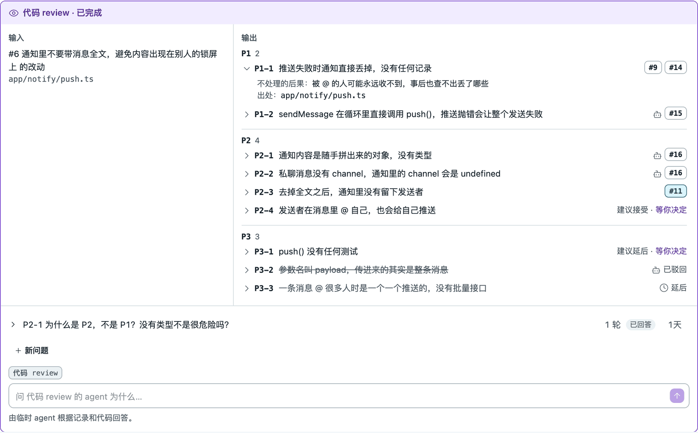
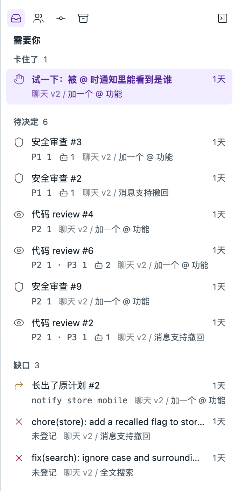
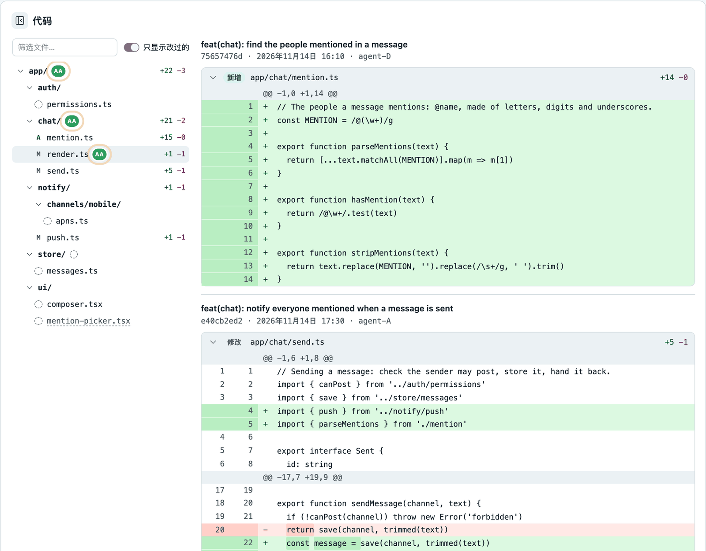

# workriver

[English](../README.md)

在很多 coding agent 同时干活的时候，仍然知道发生了什么。


## 一个人，二十个 agent

你把一个目标拆成几块，每块交给一个 agent：一个写解析，一个接通知，两个审查别人写的代码，还有一个补测试。到下午，你的几个 Herdr 工作区里已经跑着二十个会话，而真正要紧的几个问题却很难回答：

- **每个 agent 现在在做什么？** 答案散在二十个终端里。你只能挨个切窗格，看每个屏幕的最后几行。
- **这份工作为什么变成现在这样？** 审查要求改一处，你在一个终端里点了头，另一个终端里的 agent 改掉了。一周后只剩下代码，当时的理由早就滚出了屏幕。
- **它动了哪些代码？** 分支和提交只说改了什么，不说是哪个任务要求的，也不说回应的是哪次审查。
- **什么在等你？** 某个 agent 在你没在看的窗格里等你批准；一次没人做的手动试用卡住了整条分支；发现越积越多，没人决定。

workriver 就是放这些答案的地方。它作为一个服务跑在你自己的机器上，在工作发生的时候把它记下来，在浏览器里给你看。它只记录和展示，不启动 agent，也不排期。

## 它怎么工作

有三样东西喂给它：

- **agent 自己报告在做什么**：在自己的 shell 里运行 `workriver` 命令行，所有 harness 都能做到。开始时 `workriver task start u1#3`，每个提交信息里写一行 `Task: u1#3`，交付时 `workriver task deliver u1#3 --evidence 'cargo test => passed: 12 passed'`。服务根据命令在哪里运行来判断是谁，所以不用配置任何 harness，也没有谁能靠自称变成别人。
- **[Herdr](https://herdr.dev) 告诉它谁在运行**、在哪里、处于什么状态，并把消息送到 agent 那里。
- **每个 Herdr 工作区有一个管理者 agent 负责规划。** 它从项目的路线图里开始一个意图，拆成单元和任务，再交给干活的 agent。workriver 记录和传达，管理者排期。

它们报告的内容汇成一张图，用到几个词。**项目**是装着若干仓库的目录。**意图**是其中的一个目标。**单元**是意图里可以独立实现的一块，在自己的分支上做。**任务**是交给一个 agent 的一份工作（实现、审查、测试），或者交给你的：**手动步骤**（gate），只有你能做的一步，比如手动部署或试用，agent 在等它。**发现**是审查找到的问题。**检查**（evidence）是对一个任务的工作跑过的检查，命令和结果。

## 一个意图，从目标到合并

下面的图来自界面自带的示例数据：一个聊天应用。

**目标。** 聊天应用要加上 @ 人、撤回消息和搜索。意图“聊天 v2”带着一句话的目标排在项目的路线图里。你在一个 Herdr 工作区里开始它；它的管理者把它拆成几个单元，其中一个是“加一个 @ 功能”，分支是 `feat/mention`，然后把第一批任务交出去。

**工作是一张图。** 在单元里，每个任务都是活动图上的一个节点，有输入和输出。#1 找出消息里被 @ 的人，#2 通知他们，每一步后面跟着审查。审查提出发现时，流程分叉：每条被接受的发现引出新的任务，工作汇到一起的地方，线也汇到一起。虚线是正在流动的工作；紫色数字表示等你决定的发现。


**一个节点为什么是这样。** 选中一个节点，详情里写着输入了什么、产出了什么。任务 #1 的要求是从消息文本里找出被 @ 的人；它交付了提交“feat(chat): find the people mentioned in a message”和一项检查：`npm test app/chat/mention.test.ts`，6 个通过。检查不管是谁跑的，记录方式都一样。下面可以问为什么：一个临时 agent 根据记录和代码回答，只有做这份工作的 agent 空闲时才去问它。


**发现，只决定一次。** 对 #6 的代码 review 找到九个问题，按 P1 到 P3 分级。每一条要么接受，要么修改（接受，但按你的方式改），要么驳回，要么延后。P1-1 被接受，引出了任务 #9 和 #14；P3-2 被驳回；P3-3 延后，进了项目的待办；P2-4 在等你，旁边是审查者的建议。默认由意图的管理者决定发现，你随时可以改成别的决定。每个决定都会送到管理者那里；被接受的发现会一直显示在它引出的任务上，因为那些工作必须满足它。



**什么在等你。**“需要你”是跨所有工作区的一条队列。最前面是卡住别人的：在终端里等人的 agent，以及手动步骤。这里有个 agent 在等你试一下：被 @ 时，通知里能不能看到是谁。接着是要你决定的发现，然后是缺口，比如没写任务编号的提交、长出原计划的分支，最后是不卡任何人的杂事。



**它动了哪些代码。** 活动图下面，是这个单元的改动：左边文件树，右边逐个提交的 diff。任务计划要改、还没动的文件显示为虚线圆圈；有 agent 正在写的文件上带着它的标记。



**合并。** 试用通过，你把手动步骤标为做完，最后几个任务交付，分支合并。workriver 从 git 里看到合并，这个单元显示“已合并”和日期。意图的所有单元都合并或结束后，它的标题会显示“已完成”，由它的管理者把它关掉。

## 状态

第一个版本，可以用了。服务能记录意图、单元、任务、发现和杂事，从 git 读出各单元的提交，跟踪在 Herdr 里运行的 agent，维护每个项目的路线图和待办，把你的决定和手动步骤的结果送到该送的 agent，并让网页界面显示真实数据。其他机器上的 agent（每台机器跑自己的 Herdr）可以通过 ssh 跟踪；这部分是新的，目前只用替身测试过。

## 构建和运行

从一台新 Mac 到每个 Herdr 工作区都有管理者 agent，一步一步：[上手](getting-started.zh-CN.md)。

运行时由 [mise](https://mise.jdx.dev) 管理（`mise.toml`：Rust 和 Node）。网页界面会打进二进制文件里，所以先构建界面：

```
cd frontend/web && npm install && npm run build && cd ../..
cargo build --release
./target/release/workriver serve          # http://127.0.0.1:47820
./target/release/workriver open           # 打开页面，以你的身份登录（一次性链接）
```

页面和命令行只有带着你机器上的用户令牌才算是你；agent 和其他机器不行。它能防什么、防不住什么：[安全模型](security.zh-CN.md)。

数据在 `~/workriver-data/workriver.db`（用 `WORKRIVER_HOME` 换位置）。`workriver --help` 说明各个命令。一个工作区的管理者用 `workriver manager here` 登记，`workriver guide manager` / `workriver guide worker` 打印给 agent 的说明。Herdr 的 socket 是 `~/.config/herdr/herdr.sock`（或 `HERDR_SOCKET_PATH`）；没有 Herdr 时服务照常记录和显示，只是看不到 agent。

改界面时：在 `frontend/web` 里 `npm run dev` 连正在运行的 `workriver serve`；`npm run dev:mock` 改用示例数据。

## 许可

[MIT](../LICENSE)
