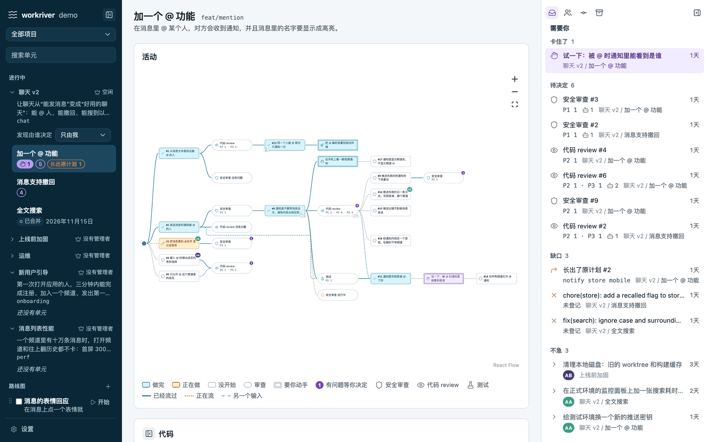
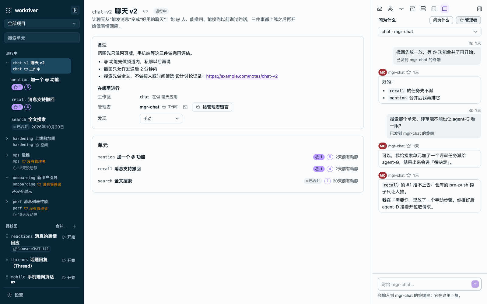
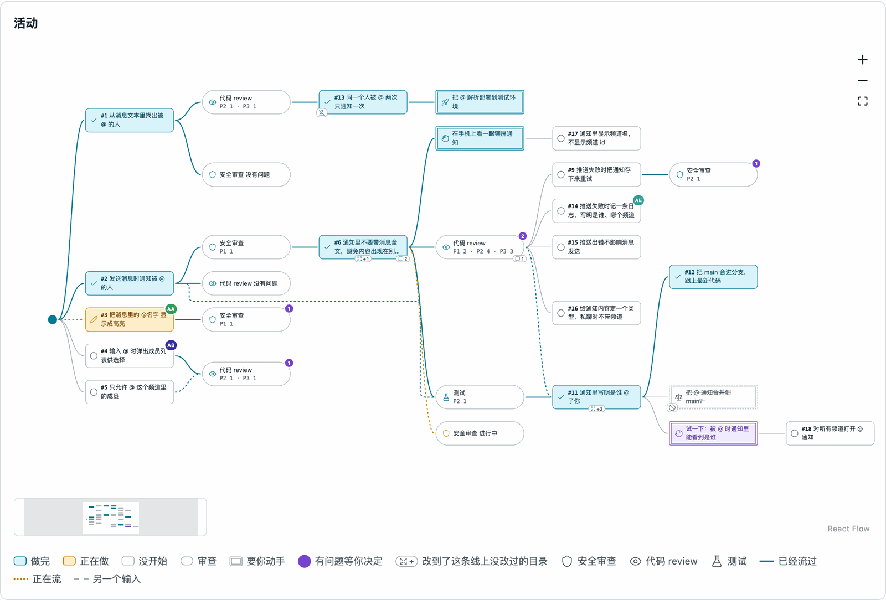
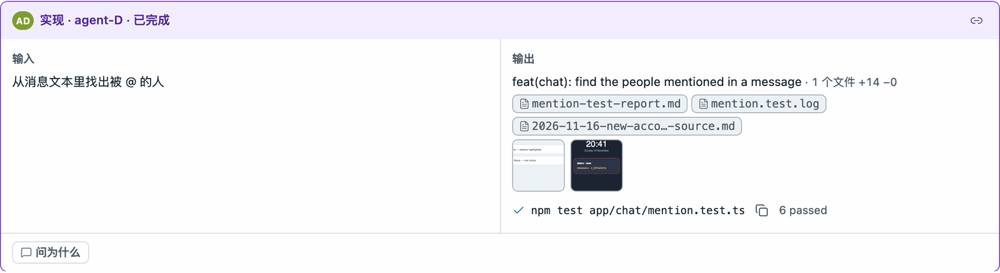
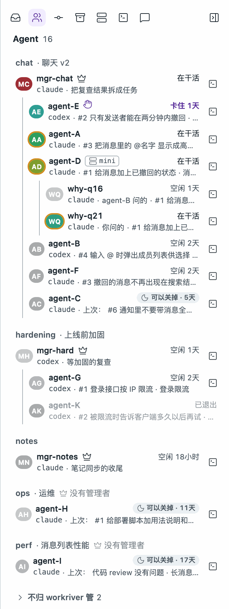

# workriver

[English](../README.md)

在很多 coding agent 同时干活的时候，仍然知道发生了什么。



## 一个人，二十个 agent

你把一个目标拆成几块，每块交给一个 agent：一个写解析，一个接通知，两个审查别人写的代码，还有一个补测试。到下午，你的几个工作区里已经跑着二十个会话，而真正要紧的几个问题却很难回答：

- **每个 agent 现在在做什么？** 答案散在二十个终端里。你只能挨个切终端，看每个屏幕的最后几行。
- **这份工作为什么变成现在这样？** 审查要求改一处，你在一个终端里点了头，另一个终端里的 agent 改掉了。一周后只剩下代码，当时的理由早就滚出了屏幕。
- **它动了哪些代码？** 分支和提交只说改了什么，不说是哪个任务要求的，也不说回应的是哪次审查。
- **什么在等你？** 某个 agent 在你没在看的终端里等你批准；一次没人做的手动试用卡住了整条分支；发现越积越多，没人决定。

workriver 就是放这些答案的地方。它作为一个服务跑在你自己的机器上，在工作发生的时候把它记下来，在浏览器里给你看。它只记录和展示，不启动 agent，也不排期。

## 它怎么工作

有三样东西喂给它：

- **agent 自己报告在做什么**：在自己的 shell 里运行 `workriver` 命令行，所有 harness 都能做到。开始时 `workriver task start u1#3`，每个提交信息里写一行 `Task: u1#3`，交付时 `workriver task deliver u1#3 --evidence 'cargo test => passed: 12 passed'`。服务根据命令在哪里运行来判断是谁，所以不用配置任何 harness，也没有谁能靠自称变成别人。
- **agent 运行时告诉它谁在运行**、在哪里、处于什么状态，并把消息送到 agent 那里。目前它是 [Herdr](https://herdr.dev)：属于 Herdr 自己的内容见 [runtimes/herdr.zh-CN.md](runtimes/herdr.zh-CN.md)。
- **每个工作区有一个管理者 agent 负责规划。** 它把一个意图拆成单元和任务，再交给它按名字启动的干活的 agent。需要你的时候（合并、部署、任何有破坏性的事之前），它通过“需要你”来问，而不是在自己的终端里问；它要告诉你的事也送到那里。干活的 agent 卡在只有你能做的事上（推送被拒、缺一次登录）时，会在自己的任务前放一个阻塞，你做完它就接着干。workriver 记录和传达，管理者排期。

它们报告的内容汇成一张图，用到几个词。**项目**是装着若干仓库的目录。**意图**是其中的一个目标。**单元**是意图里可以独立实现的一块，在自己的分支、自己的 worktree 里做；属于整个意图的调研和设计放在调研单元里，它没有分支，也从不合并；一次实验放在实验单元（spike）里，代码留在它的分支上以示做法，永不合并。**任务**是交给一个 agent 的一份工作（实现、审查、测试、设计、调研），或者交给你的：**手动步骤**（gate，界面上写作“要你动手”），只有你能做的一步，比如手动部署、试用或一个决定，agent 在等它；agent 卡住时放在自己任务前的手动步骤叫**阻塞**。**发现**是审查、测试或手动步骤找到的问题。**检查**（evidence）是对一个任务的工作跑过的一条命令和它的结果。

## 一个意图，从目标到合并

下面的图来自界面自带的示例数据：一个聊天应用。

**目标。** 聊天应用要加上 @ 人、撤回消息和搜索。意图“聊天 v2”带着一句话的目标排在项目的路线图里。你点它旁边的“开始”，选工作区“chat”；那里的管理者 mgr-chat 收到通知，把意图拆成几个单元，其中一个是“加一个 @ 功能”，分支是 `feat/mention`。意图有自己的页面：目标，随着决定越写越多的备注，在哪里进行，发现由谁决定，以及它的各个单元和每个单元的进展。“给管理者留言”在旁边打开一段对话：你写的话会打进 mgr-chat 的终端，它的回复回到页面上。管理者也可以先开口；这里它告诉你，另一个单元的一次推送在等你。



**工作是一张图。** 在单元里，每个任务都是活动图上的一个节点，有输入和输出。#1 找出消息里被 @ 的人，#2 通知他们，每一步后面跟着审查。审查提出发现时，流程分叉：每条被接受的发现引出新的任务，工作汇到一起的地方，线也汇到一起。琥珀色的点线是正在流动的工作，虚线是“另一个输入”；紫色数字表示等你决定的发现。阻塞带一个“!”标记，被它卡住的任务带一只紫色的手；这个单元里没有阻塞（单元“消息支持撤回”里有），靠近末尾那个试用手动步骤上的手是它自己的标志。节点下方的小“+N”表示它的提交改到了这条线上之前没人改过的 N 个目录：工作在那里超出了原来的范围。很长的图打开时停在最新的工作上，角上的小地图显示全貌；像这里这样缩小，整张图都能看到。



**一个节点为什么是这样。** 选中一个节点，详情里写着输入了什么、产出了什么。任务 #1 的要求是从消息文本里找出被 @ 的人；它交付了提交“feat(chat): find the people mentioned in a message”、报告和截图，以及一项检查：`npm test app/chat/mention.test.ts`，6 个通过。检查不管是谁跑的，记录方式都一样。“问管理者”在侧栏里打开和意图的管理者的对话，这个任务作为标签带上；选中的代码行、发现或正在看的截图也会作为标签带上，拖进来或粘贴的文件也一样。管理者自己回答，或者去问做这份工作的 agent，再把回答转给你。以前关于一个任务的提问，仍然可以在它的详情里看到。



**发现，只决定一次。** 对 #6 的代码 review 找到九个问题，按 P1 到 P3 分级。每一条要么接受，要么修改（接受，但按你的方式改），要么驳回，要么延后。默认由意图的管理者决定：它做的决定带一个小机器人标记，比如 P1-2 和被驳回的 P3-2，你随时可以改成别的决定。P1-1 被接受，引出了任务 #9 和 #14；P3-3 延后，进了项目的待办，在那里和别的延后发现一起成批做掉，或者放弃。“聊天 v2”在自己的页面上设成了“发现：手动”，所以还没决定的都在等你：P2-4 和 P3-1，旁边各有审查者的建议。每个决定都会送到管理者那里；被接受的发现会一直显示在它引出的任务上，因为那些工作必须满足它。


**什么在等你。**“需要你”是跨所有工作区的一条队列。最前面是卡住别人的：在终端里等人的 agent，停下来却没交付的 agent，以及手动步骤，其中也包括管理者问你的问题（现在合并吗？用哪个方案？）和干活的 agent 放的阻塞。这里 agent-E 在问能不能运行 `npm test`；一个手动步骤在等你试一下：被 @ 时，通知里能不能看到是谁；单元“消息支持撤回”的一个阻塞请你推送它的分支，因为仓库的钩子只让人推。手动步骤的步骤写着要做什么，带命令的步骤旁边有“运行”，你确认后就在你自己的 shell 里运行。你看确认框的时候，一个临时 agent 读这条命令和它调用的脚本，说出它会改动什么，并给出结论：没问题、留意或危险。它只提醒，由你决定。最近几次运行留在侧栏的“运行命令”里。接着是超过告警阈值的机器、要你决定的发现、管理者写给你还没读的消息，再是缺口，比如没写任务编号的提交，最后是不卡任何人的杂事。每一组都能点标题折起来；这里“机器”和“待决定”是折起来的。


**谁在做什么。** Agent 按工作区排成一棵树：管理者，它下面的干活的 agent 和各自在做的任务，回答问题的临时 agent 排在被问到的那个 agent 下面。卡住的 agent 带着紫色的手排在最前，已经不在的变灰，闲着又没事做的会标出“可以关掉”。“机器”显示本机和通过 ssh 跟踪的其他机器的 CPU、内存、内存压力、交换区和磁盘，重活就不会派给已经吃力的机器。



**它动了哪些代码。** 活动图下面，是这个单元的改动：左边文件树，右边逐个提交的 diff。任务计划要改、还没动的文件显示为虚线圆圈；有 agent 正在写的文件上带着它的标记。侧栏的“提交”把所有单元的提交画成一张 git 图，每个分支一条道，最上面是 agent 正在写的内容。


**合并。** 试用通过，你把手动步骤标为做完，最后几个任务交付。管理者在“需要你”里问要不要合并；你同意后，推送、开 pull request 和合并各是一个单独的任务。workriver 从 git 里看到合并，这个单元显示“已合并”和日期；squash 合并在 git 里看不出来，workriver 会指出来，由管理者记下。之后管理者删掉这个单元的 worktree。调研单元和实验单元从不合并：它的工作都决定了，就显示“可以结束”。意图的所有单元都合并或结束后，它的标题会显示“可以结束”，由它的管理者把它关掉，连同不再需要的 agent。

## 状态

第一个版本，可以用了。服务能记录意图、单元、任务、发现和杂事，从 git 读出各单元的提交，跟踪在运行时里运行的 agent，维护每个项目的路线图和待办，把你的决定、手动步骤的结果和留言送到该送的 agent，在 agent 读过命令会做什么之后，在你自己的 shell 里运行你确认过的命令，监看机器的负载，并让网页界面用英文、中文和日语显示真实数据。其他机器上的 agent（每台机器跑自己的运行时）可以通过 ssh 跟踪；这部分是新的，目前只用替身测试过。

## 构建和运行

从一台新 Mac 到每个工作区都有管理者 agent，一步一步：[上手](getting-started.zh-CN.md)。

运行时由 [mise](https://mise.jdx.dev) 管理（`mise.toml`：Rust、Node 和 pnpm）。网页界面会打进二进制文件里，所以先构建界面：

```
cd frontend/web && pnpm install && pnpm build && cd ../..
cargo build --release
./target/release/workriver serve          # http://127.0.0.1:47820
./target/release/workriver open           # 打开页面，以你的身份登录（一次性链接）
```

页面和命令行只有带着你机器上的用户令牌才算是你；agent 和其他机器不行。它能防什么、防不住什么：[安全模型](security.zh-CN.md)。

数据在 `~/workriver-data/workriver.db`（用 `WORKRIVER_HOME` 换位置）。`workriver --help` 说明各个命令。一个工作区的管理者在自己的终端里用 `workriver manager here` 登记，每个工作区一个，`workriver guide manager` / `workriver guide worker` 打印给 agent 的说明。服务在哪里找运行时：[runtimes/herdr.zh-CN.md](runtimes/herdr.zh-CN.md)；没有运行时，服务照常记录和显示，只是看不到 agent。

改界面时：在 `frontend/web` 里 `pnpm dev` 连正在运行的 `workriver serve`；`pnpm dev:mock` 改用示例数据。代码的各部分在哪里：[architecture.zh-CN.md](architecture.zh-CN.md)。

## 许可

[MIT](../LICENSE)
